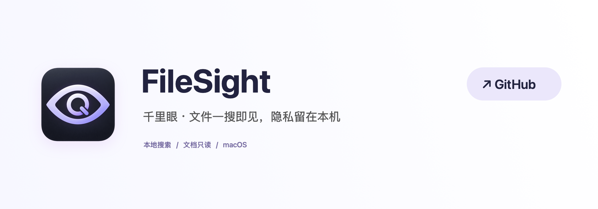

**中文** · [English](README_EN.md)

[](https://github.com/jockerxb/FileSight)

# 千里眼 · FileSight

**文件一搜即见，隐私留在本机。**

千里眼是一款原生 macOS 本地搜索工具。按下快捷键，可以启动本机 App，也可以从下载目录或你选择的文件夹中找到文件，再到 Finder 中定位。没有账号、上传或联网搜索，也不提供修改和删除文档的操作。

[下载 v2.1 预览版](https://github.com/jockerxb/FileSight/releases/tag/v2.1) · [使用指南](docs/USER_GUIDE.zh-CN.md) · [源代码](https://github.com/jockerxb/FileSight)

## 应用场景

下载目录堆满了发票、表格和资料，只记得文件名中的几个字；同名文件有好几个版本，希望按名称匹配程度和最近修改时间找到需要的那一份。

## 基础功能

- **随时呼出**：常驻菜单栏，默认 `⌘↑` 呼出搜索。快捷键可在设置中点击直接录入。
- **启动本机 App**：App 结果不等待文件搜索，支持中英文本地化名称、拼音和首字母，按回车立即启动。
- **按名称查找**：支持中文、英文、扩展名和空格分隔的多个关键词；同名文件显示各自路径。
- **拼音与首字母**：输入完整拼音或首字母，可以搜索中文 App 与中文文件名。
- **类型与日期筛选**：例如输入 `最近1个月 发票 pdf`，只显示最近一个月修改过的发票 PDF；筛选条件会显示为可移除标签。
- **排序可选**：默认完整名称优先，其次开头匹配、包含匹配，同级最近修改优先；也可按修改时间、创建时间、文件类型、文件名排序。
- **自动更新索引**：运行期间跟踪授权目录的文件变化，无需每天重新扫描整个目录。
- **及时响应**：快捷键先显示搜索面板，索引状态在后台更新；范围过大时显示当前最佳结果，不无限等待。
- **轻量设置**：普通、暗夜或跟随系统外观，支持登录时启动；回车定位 Finder，也可复制路径。

## 隐私与文件安全

搜索只读取 App 名称、图标以及文件名、路径、时间等元数据，不读取文档正文。App 从 macOS 标准本地应用位置读取，不受文件搜索目录限制。主程序和扫描助手启用 App Sandbox，无网络权限，授权目录只读。索引及搜索词仅在内存中使用，退后不保留。

文件搜索默认为“下载”，首次需选择目录授权；同一目录的只读凭证保存在 App 沙盒内，后续启动自动恢复，可在设置中取消。不扫描网络卷，不跟随符号链接，也不主动下载云端文件。GitHub 按钮仅由用户主动点击后交给浏览器打开项目页。

[查看隐私设计与验证说明](PRIVACY.md)

## 安装与开始使用

1. 下载 Release 中的 `FileSight.zip`，解压并将「千里眼.app」放入「应用程序」。
2. 打开 App，点击「授权下载…」，或在范围菜单选择本地目录。
3. 输入 App 或文件名。App 结果按 `↩` 启动，文件结果按 `↩` 到 Finder 定位；`Esc` 收起。

右键点击菜单栏图标 → **设置…**，调整外观、呼出快捷键与登录时启动。`⌘↑` 也用于 Finder 返回上一级，若与你的习惯冲突，可直接更换组合。

## 适配系统

| 项目 | 当前支持 |
| --- | --- |
| macOS | macOS 13 Ventura 及以上 |
| 下载包 | Apple Silicon（arm64） |
| App 界面 | 中文；本项目说明提供中英文 |
| 搜索内容 | 本地文件及文件夹名称，不搜索正文 |

> 当前为未经过 Apple 公证的预览版，首次打开可能被 macOS 拦截。请先确认来自本仓库，再参考 [Apple 官方打开说明](https://support.apple.com/zh-cn/102445)。无需关闭系统整体安全保护。Apple 正式分发支持后续再做。

<details>
<summary>源码构建与验证</summary>

需要 Apple Command Line Tools、Swift 5.10 或更新版本，无第三方运行时依赖。

```sh
git clone https://github.com/jockerxb/FileSight.git
cd FileSight
zsh scripts/build-app.sh --preview
zsh scripts/verify.sh
python3 scripts/verify-privacy.py
```

构建结果位于 `dist/千里眼.app` 和 `dist/FileSight.zip`。构建自动检查签名和权限。搜索测试覆盖大量结果、所有排序方向、目录边界、文件变化及扫描助手超时恢复；隐私测试使用一次性文件与本机回环端口，不连接互联网。

</details>

## 支持与反馈

欢迎 [提交 Issue](https://github.com/jockerxb/FileSight/issues)，附上 macOS 版本和复现步骤；请用示例文件名代替个人文档信息。

如果千里眼帮你更快找到了文件，欢迎点一个 [Star ⭐](https://github.com/jockerxb/FileSight)。
