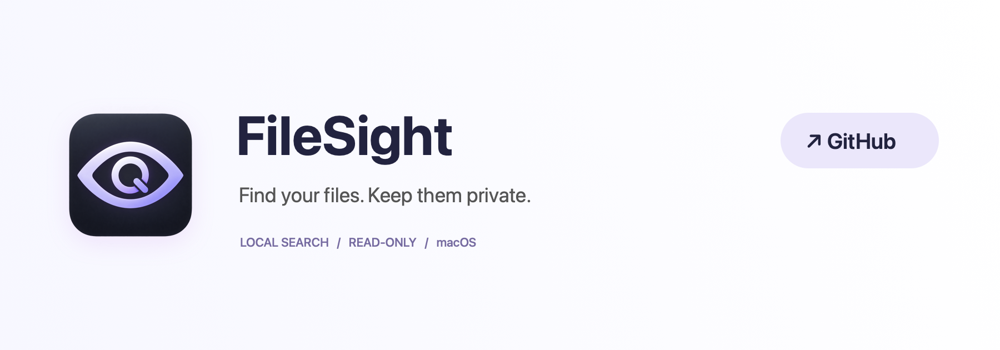

[中文](README.md) · **English**

[](https://github.com/jockerxb/FileSight)

# FileSight · 千里眼

**Find your files. Keep them private.**

FileSight is a native macOS filename search app. Press a shortcut, type part of a filename, and find it in Downloads or a folder you choose. Reveal the result in Finder when you need it. No accounts, uploads, or online search; no document editing or deletion actions.

[Download v2.1 preview](https://github.com/jockerxb/FileSight/releases/tag/v2.1) · [Detailed guide (中文)](docs/USER_GUIDE.zh-CN.md) · [Source code](https://github.com/jockerxb/FileSight)

## When to use FileSight

Your Downloads folder is full of invoices, spreadsheets, and reference files. You remember a few words in a filename, or need to distinguish several versions by name match and modification date.

## Features

- **A shortcut away:** Lives in the menu bar. Press `⌘↑` to search, or click the shortcut field in Settings to record your own combination.
- **Filename search:** Chinese, English, extensions, and multiple space-separated keywords. Separate paths distinguish files with the same name.
- **Flexible sorting:** Exact names first, then prefix and substring matches; newest modification first within each tier. You can also sort by modification date, creation date, file type, or filename.
- **Automatic index updates:** Tracks changes in authorized folders while running, without a daily full-folder scan.
- **Simple settings:** Light, dark, or system appearance and optional launch at login. Reveal results in Finder or copy their paths.

## Privacy and file safety

Search reads names, paths, timestamps, and other metadata, not document contents. Both the app and its scanner use App Sandbox with no network entitlements and read-only access to authorized folders. The index and queries stay in memory and are not retained after quitting.

Select a folder to authorize search; select it again after restarting the app. FileSight skips network volumes, does not follow symbolic links, and does not request cloud-file downloads. Clicking the GitHub button explicitly opens the project page in your browser.

[Privacy design and verification (中文)](PRIVACY.md)

## Install and get started

1. Download `FileSight.zip` from the release, unzip it, and move **千里眼.app** into **Applications**.
2. Open the app. Click **授权下载…** (Authorize Downloads), or choose a local folder from the scope menu.
3. Type a filename. Use `↑↓` to select, `Return` to reveal in Finder, and `Esc` to dismiss.

Right-click the menu bar icon → **设置…** (Settings) to change appearance, the shortcut, or launch at login. `⌘↑` is also Finder's parent-folder shortcut; record another combination if needed.

## Requirements

| Item | Current support |
| --- | --- |
| macOS | macOS 13 Ventura or later |
| Download package | Apple Silicon (arm64) |
| App interface | Chinese; project documentation is bilingual |
| Search content | Local file and folder names, not document contents |

> This preview is not notarized by Apple and may be blocked on first launch. Verify that it came from this repository, then consult [Apple's opening instructions](https://support.apple.com/102445). You do not need to disable system-wide security protections. Apple distribution support is deferred.

<details>
<summary>Build from source and verify</summary>

Requires Apple Command Line Tools and Swift 5.10 or later, with no third-party runtime dependencies.

```sh
git clone https://github.com/jockerxb/FileSight.git
cd FileSight
zsh scripts/build-app.sh --preview
zsh scripts/verify.sh
python3 scripts/verify-privacy.py
```

Outputs: `dist/千里眼.app` and `dist/FileSight.zip`. Building checks signatures and entitlements. Search verification covers large result sets, every sort direction, directory boundaries, file changes, and scanner timeout recovery. Privacy tests use disposable files and a local loopback listener, with no internet connection.

</details>

## Support and feedback

[Open an issue](https://github.com/jockerxb/FileSight/issues) with your macOS version and reproduction steps. Use sample filenames instead of personal document information.

If FileSight helps you find your files faster, give it a [Star ⭐](https://github.com/jockerxb/FileSight).
